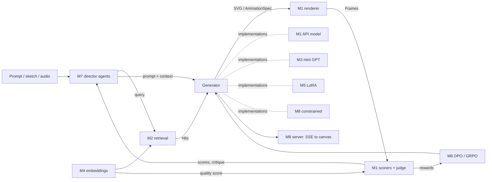

# Vector Director design

Status: scaffold (no milestone implemented yet). Source plan: "AI Bootcamp × Vector Animation: Project Plan".

## Goal

Prompt (or sketch, or song) in, animated SVG out. Each bootcamp technique is a swappable part
behind a small set of interfaces, so every experiment can be scored the same way and compared.

## Architecture

The agents are the product; the generator, embeddings and scorers are where most of the
learning happens. The eval harness is built first and its scores later become training rewards.

## The one rule: modules meet only through `core`

`core` holds the contracts. Milestone packages import from `core`, never from each other's
internals, except through the Protocols below. That keeps any milestone replaceable and lets
them be built in any order after M1.

| Contract | Defined in | Meaning | Implemented by |
|----------|-----------|---------|----------------|
| `AnimationSpec` | `core/spec.py` | Objects (SVG fragments) + tracks of keyframes per property | written by generators, read by renderer and agents |
| `Generator` | `core/interfaces.py` | `generate(prompt, context) -> GenerationResult` | M1 API, M3 mini GPT, M5 LoRA, M6 tuned, M8 constrained |
| `StreamingGenerator` | same | adds `stream()` yielding SVG text | M8 |
| `Renderer` | same | `render(svg, fps) -> Frames` | M1 Playwright |
| `Scorer` | same | `score(Sample) -> {metric: value}` | M1 validity/CLIP/motion, M4 quality head |
| `Critic` | same | `critique(Sample) -> (score, feedback)` | M1 vision judge, M7 critic agent |
| `Embedder` | same | text and images to one vector space | M2 CLIP, M4 fine-tuned CLIP |
| `Retriever`, `Reranker` | same | `search(query, k) -> [Hit]` | M2 BM25, vector, hybrid, HyDE, cross-encoder |
| `RewardFn` | same | `(prompt, svg) -> float` | M6 weighted scorers |

Data types (`core/types.py`): `GenerationResult`, `Frames`, `Sample`, `Hit`, `Scores`.

## The scoreboard

`m1_harness.harness.evaluate(generator, prompts, renderer, scorers, retriever=None)` is the shared
yardstick. Every milestone's "done when" is a row on it:

| Metric | Source | Notes |
|--------|--------|-------|
| `valid` | M1 ValidityScorer | parses and renders non-blank |
| `clip` | M1 ClipScorer | prompt vs frames cosine similarity |
| `motion` | M1 MotionScorer | mean frame difference; watch for flicker hacks |
| `judge` | M1 VisionJudge | rubric score from a vision LLM |
| `quality` | M4 QualityRegressorHead | learned aesthetic score |
| `recall@10`, `mrr` | M2 metrics | retrieval only, on a labeled query set |

## Build order

M1 first, always. After that the dependency is loose:

- M2 needs M1 (to show retrieval helps) and an Embedder.
- M3 needs only data; it is self-contained.
- M4 needs M2's library and renders.
- M5 needs M1 (to filter distilled data and score the result).
- M6 needs M5 (a model to tune) and M1 (rewards), optionally M4.
- M7 needs a Generator, a Critic and a Retriever.
- M8 needs a Generator worth serving.

## Conventions

- Each milestone's heavy dependencies are an extra in `pyproject.toml` (`.[m1]` ... `.[m8]`).
- Stubs raise `NotImplementedError("Mn: ...")`; a module is done when its README's "done when" holds.
- Data and run outputs go in `data/` and `experiments/` and stay out of git.
- GPU jobs (M5, M6, M8) run on Modal or Colab; everything through M4 runs on a laptop.

## Open questions

- [ ] What does `sadhu` animate with (CSS, SMIL, GSAP, its own engine)? That fixes `spec_to_svg`'s target
      and how its canvas consumes M8's stream.
- [ ] Which API model for the M1 generator and judge?
- [ ] SVG sources and licenses for the M2 library (Tabler, Lucide, Phosphor, OpenMoji, HF datasets).
